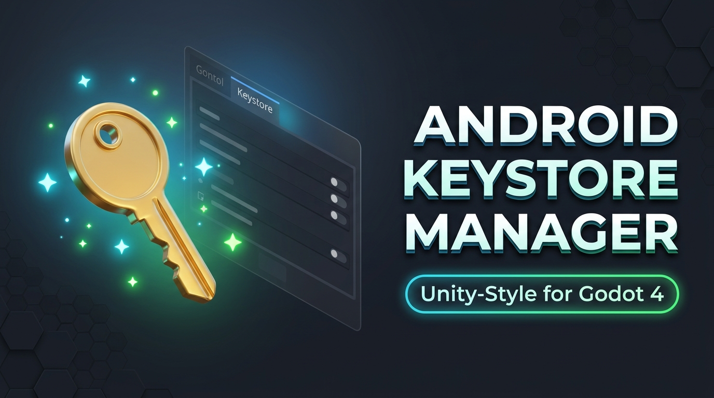

# Android Keystore Manager for Godot 4



A clean, Unity-style Android Keystore Creator & Manager for the Godot Engine.

Say goodbye to remembering long and tedious `keytool` command lines in terminal! Create release keystores directly inside the **Export Dialog** or via a dedicated popup window, with automatic export preset configuration.

---

## ✨ Features

- 🎯 **Export Dialog Tab**: Seamlessly injects a **Keystore** tab right next to the *Scripts* tab in Godot's built-in Export window.
- 🚀 **Standalone Access**: Access anytime from the top menu via **Project > Tools > Android Keystore Manager**.
- 🛠 **Unity-Style Workflow**:
  - Custom file destination (`res://` or anywhere on disk).
  - Password fields with show/hide (👁) toggle.
  - *"Use same password as Keystore"* option for quick setup.
  - Full certificate info (Alias, Validity in years, First/Last name, Organization, City, State, Country).
- ⚡ **Auto-Fill Export Preset**: Automatically configures the `Release Keystore`, `Release User` (alias), and `Release Password` in your active Android preset (`export_presets.cfg`).
- 🔄 **Auto FileSystem Scan**: Automatically scans the project filesystem so your new `.keystore` appears in the FileSystem dock immediately.
- 🌐 **Cross-Platform**: Automatic `keytool` detection on Windows, macOS, and Linux.

---

## 📋 Requirements

- **Godot 4.x** (compatible with 4.0 through 4.7+)
- **Java JDK / OpenJDK** (JDK 11, 17, or newer)
  - Ensure the **Java SDK Path** is set under **Editor > Editor Settings > Export > Android > Java SDK Path** (points to your JDK root folder).

---

## 📦 Installation

### From Godot Asset Library
1. In Godot, open the **AssetLib** tab at the top.
2. Search for **Android Keystore Manager**.
3. Click **Download** and **Install**.
4. Go to **Project > Project Settings > Plugins** and enable **Android Keystore Manager**.

### Manual Installation
1. Clone or download this repository.
2. Copy the `addons/keystore_manager` folder into your project's `addons/` directory:
   ```
   your_project/
   └── addons/
       └── keystore_manager/
   ```
3. In the Godot editor, go to **Project > Project Settings > Plugins** and enable **Android Keystore Manager**.

---

## 🚀 How to Use

### Method 1: Inside the Export Window
1. Open **Project > Export...**.
2. Select your **Android** export preset.
3. Click the new **Keystore** tab located in the tab bar (next to *Scripts*).
4. Enter your Keystore password and customize details (or keep defaults).
5. Ensure *"Auto-fill credentials into active Android Export Preset"* is checked.
6. Click **Create Keystore**. Your keystore will be generated and automatically linked to your Android export preset!

### Method 2: Standalone Menu
1. Go to **Project > Tools > Android Keystore Manager**.
2. Enter your keystore settings and click **Create Keystore**.

---

## 📄 License

This project is licensed under the [MIT License](addons/keystore_manager/LICENSE).
Created with ❤️ by **Toplayrs**.

